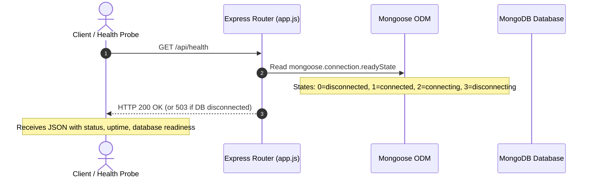

# SupportFlow — Engineering & Architecture Learning Notes

> A comprehensive, interview-ready technical companion documenting architectural choices, security controls, database design, and real-world trade-offs in SupportFlow.

---

## Table of Contents
1. [Project Overview & Core Architecture](#1-project-overview--core-architecture)
2. [Stage 2: Express Server Foundation, Environment Validation & MongoDB Connection](#2-stage-2-express-server-foundation-environment-validation--mongodb-connection)
3. [Authentication Architecture & The In-Memory JWT Decision](#3-authentication-architecture--the-in-memory-jwt-decision)
4. [Request Flow: Health Check Endpoint](#4-request-flow-health-check-endpoint)
5. [Files & Module Responsibilities](#5-files--module-responsibilities)
6. [Functions & API Reference](#6-functions--api-reference)
7. [Engineering Trade-Offs & Alternatives](#7-engineering-trade-offs--alternatives)
8. [Common Bugs & Debugging Guide](#8-common-bugs--debugging-guide)
9. [Interview Questions & Detailed Answers](#9-interview-questions--detailed-answers)
10. [Self-Study Hands-On Exercise](#10-self-study-hands-on-exercise)

---

## 1. Project Overview & Core Architecture

SupportFlow is a portfolio-grade customer support ticket management web application built on the MERN stack (MongoDB, Express, React, Node.js). It demonstrates enterprise patterns for:
- Role-Based Access Control (Customer, Support Agent, Administrator) enforced on the server.
- Decoupled client-server architecture with strict origin CORS boundaries.
- Defensive API engineering with fail-fast environment validation, sanitized Mongoose documents, and centralized error masking.
- State-machine driven ticket lifecycles and audit history.

### Directory Architecture: Two-Tier Monorepo
```text
SupportFlow/
├── client/         # React SPA (Vite, JavaScript, Vanilla CSS Design System)
├── server/         # Express REST API (Node.js, Mongoose, Jest, Supertest)
├── LEARNING_NOTES.md
└── README.md
```
*Why this layout?* Separating `client/` and `server/` with independent `package.json` manifests eliminates dependency contamination (e.g. backend libraries like `bcrypt` leaking into client bundles) and allows distinct build, deployment, and testing lifecycles.

---

## 2. Stage 2: Express Server Foundation, Environment Validation & MongoDB Connection

### 2.1 What this stage does and why it exists
Before building business logic (users, tickets, auth), an application requires a rock-solid, testable foundation:
1. **Separation of App vs. Server**: Decoupling the Express app configuration (`app.js`) from the network socket listener (`server.js`) enables instant, in-memory integration testing via Supertest without binding to live TCP ports.
2. **Fail-Fast Environment Validation**: Validating critical configuration variables (`MONGODB_URI`, `PORT`, `NODE_ENV`, `CLIENT_URL`) at startup prevents the server from entering a corrupted or partially initialized state.
3. **Mongoose Lifecycle Management**: Handling database connection events (`connected`, `error`, `disconnected`) and graceful shutdown signals (`SIGINT`, `SIGTERM`) guarantees that pending database writes finish before the Node process exits.
4. **Health Diagnostics Endpoint**: `GET /api/health` provides load balancers, orchestrators, and developers with live diagnostic metrics (database readiness, server uptime, environment).

---

## 3. Authentication Architecture & The In-Memory JWT Decision

### 3.1 Architectural Decision: In-Memory Bearer Token Only
In our initial MVP, access tokens (JWTs) are **stored strictly in React `AuthContext` memory**.
- **No `localStorage`**: The token is never written to disk or browser web storage.
- **No `sessionStorage`**: The token is never written to session storage.
- **Page Refresh Behavior**: Refreshing the browser clears JavaScript memory, requiring the user to authenticate again.

### 3.2 Security Trade-Off Analysis (Interview Critical)

```mermaid
graph TD
    subgraph LocalStorage["Approach A: localStorage Storage"]
        L1[Vulnerable to XSS] --> L2[Any injected script can read localStorage.getItem]
        L3[Persistent across page refresh]
    end

    subgraph InMemory["Approach B: In-Memory State Only (Chosen for MVP)"]
        M1[Immune to localStorage XSS token theft]
        M2[Zero CSRF vulnerability (Bearer header required)]
        M3[Trade-off: Session lost on page refresh]
    end

    subgraph HttpOnlyCookie["Approach C: HttpOnly Cookies (Future Enterprise Step)"]
        H1[Protected against XSS token extraction]
        H2[Requires anti-CSRF tokens and strict CORS credentials]
    end
```

#### Why did we choose In-Memory for the initial MVP?
1. **Mitigation of Script-Based Token Theft (XSS)**: If a third-party dependency or XSS vulnerability runs JavaScript in the browser, `localStorage.getItem('token')` exposes the user's session credentials. In-memory tokens are scoped within a React closure, significantly narrowing the attack surface.
2. **Elimination of Cross-Site Request Forgery (CSRF)**: Because the token is sent explicitly using the `Authorization: Bearer <token>` header rather than an ambient cookie, malicious cross-site forms cannot trigger authorized actions.
3. **Transparent Trade-Off**: The acknowledged drawback is user convenience: pressing `F5` or reloading the browser resets React state and prompts a login. In enterprise architectures, this is solved by pairing an in-memory short-lived access token with an HTTP-Only, SameSite refresh token cookie.

---

## 4. Request Flow: Health Check Endpoint



---

## 5. Files & Module Responsibilities

| File Path | Primary Responsibility |
| :--- | :--- |
| `server/src/config/env.js` | Parses `.env`, enforces presence of required variables (`MONGODB_URI`, `JWT_SECRET` in prod), and exports a validated configuration object. |
| `server/src/config/db.js` | Configures Mongoose, manages connection state, listens to lifecycle events (`error`, `disconnected`), and provides clean connect/disconnect methods. |
| `server/src/app.js` | Configures Express middleware (CORS, Morgan, JSON parser), declares public routes (`/api/health`), handles 404s, and provides centralized error handling. |
| `server/src/server.js` | Application entry point: calls `connectDB()`, binds Express to the designated network port, and registers graceful termination handlers (`SIGINT`, `SIGTERM`). |
| `server/.env.example` | Template committed to Git demonstrating all required and optional configuration keys with safe placeholder values. |
| `server/.env` | Local development configuration file containing real local values. **Never committed to Git**. |
| `server/tests/env.test.js` | Unit tests verifying that configuration loads correctly and fails fast when mandatory variables are absent. |
| `server/tests/db.test.js` | Integration tests verifying database connection and graceful disconnection using `mongodb-memory-server`. |
| `server/tests/health.test.js` | API tests using Supertest to verify `GET /api/health` and the 404 fallback handler. |

---

## 6. Functions & API Reference

### 6.1 `validateEnv()` (`src/config/env.js`)
- **Purpose**: Verifies that mandatory configuration parameters are defined before the application boots.
- **Parameters**: None (reads `process.env`).
- **Return Value**: An immutable configuration object `{ PORT, NODE_ENV, MONGODB_URI, CLIENT_URL, JWT_SECRET, JWT_EXPIRES_IN }`.
- **Side Effects**: Throws an immediate descriptive `Error` if any mandatory variable is missing, preventing silent boot failures.

### 6.2 `connectDB(customUri)` (`src/config/db.js`)
- **Purpose**: Connects Mongoose to the MongoDB cluster.
- **Parameters**: `customUri` (*string*, optional) — allows test harnesses (such as `mongodb-memory-server`) to supply an isolated in-memory URI.
- **Return Value**: `Promise<mongoose.Connection>` — resolves to the active connection instance.
- **Error Handling**: Catches connection failures, logs diagnostic information (in non-test environments), and rethrows so the boot sequence halts safely.

### 6.3 `GET /api/health`
- **Method**: `GET`
- **Authentication**: Public (no token required).
- **Success Response (`200 OK`)**:
```json
{
  "success": true,
  "status": "healthy",
  "timestamp": "2026-10-26T05:10:00.000Z",
  "uptime": 142.58,
  "database": {
    "status": "connected",
    "readyState": 1
  },
  "environment": "development"
}
```
- **Failure Response (`503 Service Unavailable`)**: Returned if MongoDB is disconnected (`readyState !== 1`), alerting monitoring systems that the service cannot process database traffic.

---

## 7. Engineering Trade-Offs & Alternatives

### Trade-off 1: Splitting `app.js` and `server.js`
- **Chosen**: `app.js` exports the unmounted Express application; `server.js` executes `app.listen()`.
- **Alternative**: Putting `app.listen()` directly inside `app.js`.
- **Rationale**: If `app.listen()` is executed upon module import, integration tests (via Supertest) cannot test route logic without creating real TCP port conflicts or leaving hanging socket handles. Splitting them makes automated testing fast and leak-free.

### Trade-off 2: Fail-Fast Env Validation vs. Inline Fallbacks
- **Chosen**: Explicit startup check that throws an error if `MONGODB_URI` is undefined.
- **Alternative**: Using `process.env.MONGODB_URI || 'mongodb://localhost/test'` in every file.
- **Rationale**: Inline fallbacks hide misconfigured production environments. If a production environment variable fails to inject, an app with inline fallbacks will silently connect to an unintended default host, risking data corruption or confusing runtime failures.

---

## 8. Common Bugs & Debugging Guide

### 1. `MongooseServerSelectionError: connect ECONNREFUSED 127.0.0.1:27017`
- **Symptom**: Server crashes immediately on startup.
- **Root Cause**: The local MongoDB daemon is not running, or `MONGODB_URI` points to an unreachable host/port.
- **How to debug**:
  - Run `brew services list` or `docker ps` to verify MongoDB is active.
  - Verify your connection string in `server/.env`.
  - For automated tests, we use `mongodb-memory-server`, which bypasses this by spinning up a lightweight binary automatically.

### 2. CORS Blocked: `Origin http://localhost:5173 is not allowed`
- **Symptom**: Browser frontend console shows `Access-Control-Allow-Origin` missing or mismatched.
- **Root Cause**: `CLIENT_URL` in `server/.env` does not match the actual URL where the Vite development server is running.
- **How to debug**: Check the port in your browser address bar and verify `CLIENT_URL=http://localhost:<port>` in `server/.env`.

---

## 9. Interview Questions & Detailed Answers

### Q1: Why do experienced Node.js developers separate `app.js` and `server.js`?
> **Answer**:  
> In Node.js, `app.js` encapsulates the Express application logic—registering middleware, routers, and error handlers—without binding to a network port. `server.js` is the operational entry point that handles infrastructure concerns: loading configuration, connecting to the database, binding to a TCP port via `app.listen()`, and registering process signal handlers (`SIGINT`/`SIGTERM`).  
> This separation is vital for testability. Integration testing libraries like **Supertest** can import `app` directly and execute simulated HTTP requests completely in-memory without starting a live network server, avoiding port collisions and open handle warnings.

### Q2: What are the security trade-offs between storing JWTs in `localStorage` vs. keeping them in-memory?
> **Answer**:  
> Storing a JWT in `localStorage` leaves it accessible to any JavaScript running on the page. If the application has any Cross-Site Scripting (XSS) vulnerability or an insecure third-party package, an attacker can extract the token via `localStorage.getItem('token')` and impersonate the user.  
> Keeping the token in React memory (such as inside a React `AuthContext` closure) eliminates the risk of an attacker reading the token out of web storage. The trade-off is user convenience: refreshing the browser clears memory, requiring the user to re-authenticate. In production systems, the ideal balance is often pairing an in-memory access token with an `HttpOnly`, `SameSite` refresh token cookie.

### Q3: What is "Graceful Shutdown" and why is it important in a backend service?
> **Answer**:  
> When a server receives a termination signal like `SIGTERM` or `SIGINT` (e.g., during a Docker container rotation, Kubernetes pod eviction, or pressing `Ctrl+C`), an unhandled exit abruptly terminates open HTTP connections and in-flight database transactions.  
> Graceful shutdown intercepts these signals, stops accepting new HTTP connections via `server.close()`, allows pending requests to finish responding, cleanly closes the database connection pool (`mongoose.connection.close()`), and finally exits the process with code 0. This prevents database socket leaks and request abort errors for active users.

---

## 10. Self-Study Hands-On Exercise

To solidify your understanding of how environment validation and connection management work, try this 5-minute exercise:

1. **Test Fail-Fast Validation**:
   - Open `server/.env` and temporarily comment out `MONGODB_URI` (add `#` at the start of the line).
   - In your terminal, run `npm run dev` inside the `server/` directory.
   - Observe the crash message: notice how `src/config/env.js` immediately halts execution with a descriptive error before Mongoose ever attempts to connect.
   - Restore the line in `server/.env`.
2. **Inspect the Health API**:
   - Start the server with `npm run dev`.
   - Open `http://localhost:5000/api/health` in your browser or run:
     ```bash
     curl -i http://localhost:5000/api/health
     ```
   - Notice the status code (`200 OK`), `readyState: 1`, and uptime counter.
