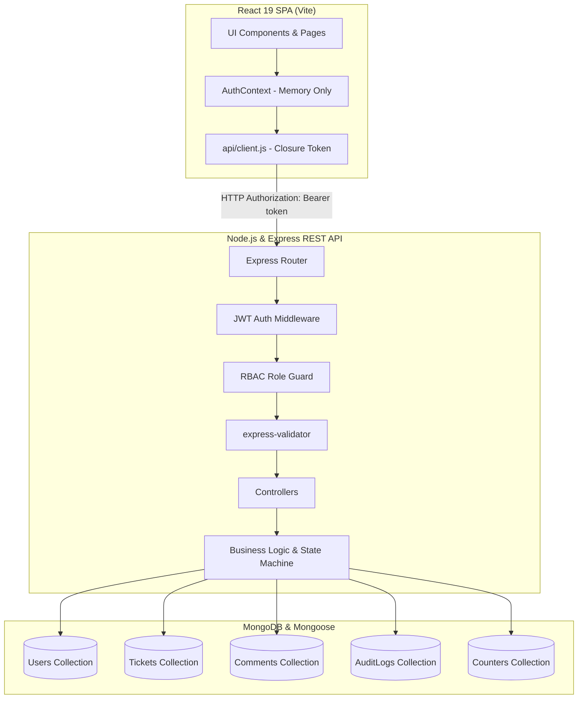
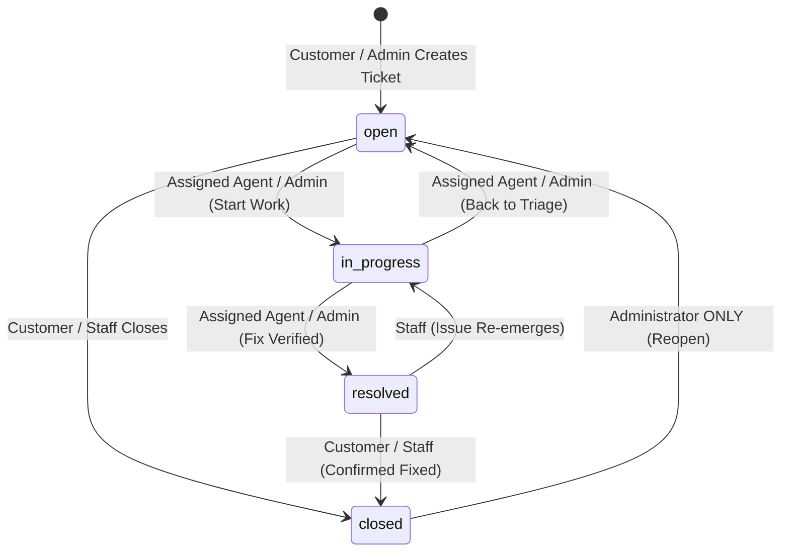
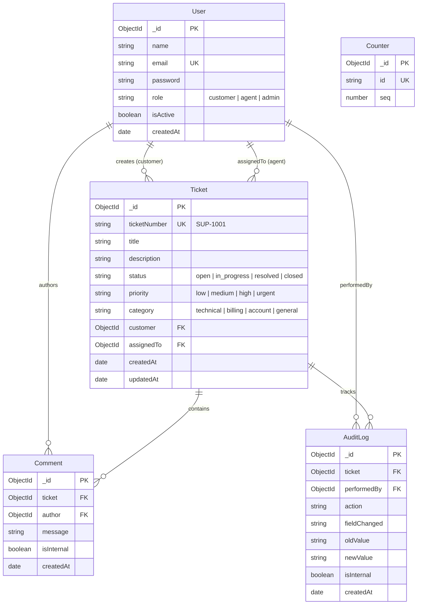

# SupportFlow — Customer Support & Ticket Lifecycle Management

SupportFlow is a portfolio-grade, full-stack customer support ticket management application built with the **MERN stack** (MongoDB, Express, React, Node.js). It demonstrates enterprise software engineering patterns including **Role-Based Access Control (RBAC)**, an **In-Memory JWT authentication architecture**, a **deterministic Finite State Machine (FSM)** for ticket lifecycles, **multi-layer internal note privacy protection**, and **MongoDB `$facet` aggregation pipelines**.

---

## Architecture Highlights

1. **In-Memory JWT Access Token Storage**:
   - Access tokens are held **strictly in React `AuthContext` runtime memory** and an in-memory API client closure.
   - Tokens are **never written to `localStorage` or `sessionStorage`**, eliminating token theft risks via Cross-Site Scripting (XSS).
   - A centralized HTTP 401 interceptor automatically detects session expiration and resets client state.
2. **Defense-in-Depth Privacy for Internal Notes**:
   - Customers can **never** view or inject private staff notes.
   - The server unconditionally applies `{ isInternal: false }` to database queries and audit logs for customer requests, and rejects client attempts to set `isInternal: true` with HTTP 403 Forbidden.
3. **Deterministic Finite State Machine**:
   - Ticket transitions follow strict business rules: `open` ➔ `in_progress` ➔ `resolved` ➔ `closed`.
   - Support Agents can only progress tickets assigned to them; closed tickets can only be reopened by a System Administrator.
4. **Atomic Sequential Ticket Identifiers**:
   - Tickets are assigned human-readable sequential keys (e.g. `SUP-1001`, `SUP-1002`) using atomic MongoDB `$inc` counters without race conditions.
5. **Single-Trip Role-Tailored Metrics**:
   - Express backend leverages MongoDB `$facet` aggregation pipelines to return status distributions, priority counts, and unassigned queue metrics in a single database round-trip.
6. **Vanilla CSS SaaS Design System**:
   - Bespoke modern dark theme using native CSS Custom Properties, glassmorphism, responsive navigation drawers, and accessible micro-animations without external CSS framework bloat.

---

## System Topology & Architecture



---

## Finite State Machine Lifecycle



---

## Technology Stack

| Domain | Technology | Purpose |
| :--- | :--- | :--- |
| **Frontend** | React 19, Vite, JavaScript | Fast, component-driven SPA with sub-second HMR and optimized production bundles |
| **Routing** | React Router DOM v7 | Declarative route guarding, URL query-string filtering, and destination preservation |
| **Icons** | Lucide React | Lightweight, accessible SVG icon library |
| **Styling** | Vanilla CSS (CSS Variables) | Native design system with dark palette, glassmorphism, and responsive tables |
| **Backend** | Node.js (v22), Express (v4) | RESTful API server with modular controllers, services, and centralized error handling |
| **Database** | MongoDB (v7), Mongoose (v8) | Document database with schema validation, compound indexes, and aggregation pipelines |
| **Security** | JSON Web Tokens (JWT), Bcrypt.js | Cryptographic password hashing (12 rounds) and stateless Bearer authorization |
| **Validation** | express-validator | Request payload and parameter sanitization with centralized error formatting |
| **Testing** | Jest, Supertest, MongoDB Memory Server | Automated integration test suite running in-memory without database side effects |

---

## Pre-Configured Demo Accounts

For fast evaluation and interview demonstration, the application includes one-click instant login buttons on the login page:

| Role | Name | Email Address | Password | Permissions & Capabilities |
| :--- | :--- | :--- | :--- | :--- |
| **Admin** | System Administrator | `admin@supportflow.com` | `AdminPassword123!` | System-wide visibility, user management, agent reassignment, and exclusive authority to reopen closed tickets. |
| **Agent** | Sarah Connor | `agent.sarah@supportflow.com` | `AgentPassword123!` | Global queue triage, ticket claiming/unclaiming, status progression on assigned tickets, and private internal notes. |
| **Agent** | Alex Murphy | `agent.alex@supportflow.com` | `AgentPassword123!` | Secondary support engineer account for testing peer assignment and multi-agent workflows. |
| **Customer** | Alice Freeman | `alice@example.com` | `CustomerPassword123!` | Submit support tickets, view public replies, post follow-ups, and mark resolved tickets as closed. |
| **Customer** | Bob Vance | `bob@example.com` | `CustomerPassword123!` | Secondary customer account for verifying multi-tenant ticket isolation. |

---

## Getting Started & Local Setup

### Prerequisites
- **Node.js**: v18.x, v20.x, or v22.x (`node -v`)
- **npm**: v9.x or v10.x (`npm -v`)
- **MongoDB**: Local MongoDB instance (`mongodb://127.0.0.1:27017`) or MongoDB Atlas connection string.

### 1. Clone the Repository
```bash
git clone https://github.com/your-username/SupportFlow.git
cd SupportFlow
```

### 2. Backend Setup (`server/`)
```bash
cd server
npm install

# Copy example environment configuration
cp .env.example .env

# Seed the database with demo accounts and tickets
npm run seed

# Start the backend server (runs on port 5001)
npm run dev
```

### 3. Frontend Setup (`client/`)
In a new terminal window:
```bash
cd client
npm install

# Copy example environment configuration
cp .env.example .env

# Start the Vite development server (runs on port 5173)
npm run dev
```

### 4. Open Application
Navigate to **`http://localhost:5173`** in your browser. Click any of the **Instant Demo Account** buttons to log in immediately.

---

## REST API Reference

All protected endpoints require an `Authorization: Bearer <token>` header.

### Authentication Endpoints
| Method | Route | Access | Description |
| :--- | :--- | :--- | :--- |
| `POST` | `/api/auth/register` | Public | Registers a new Customer account (`role` is unconditionally forced to `customer`). |
| `POST` | `/api/auth/login` | Public | Authenticates credentials and returns a JWT access token and user profile. |
| `GET` | `/api/auth/me` | Authenticated | Returns current authenticated user profile. |
| `GET` | `/api/auth/staff` | Agent, Admin | Returns list of active agents and admins for ticket assignment. |

### Ticket Management Endpoints
| Method | Route | Access | Description |
| :--- | :--- | :--- | :--- |
| `POST` | `/api/tickets` | Customer, Admin | Creates a new ticket with atomic sequential key (`SUP-XXXX`). |
| `GET` | `/api/tickets` | Authenticated | Lists tickets with role scoping, keyword search, filters, and pagination. |
| `GET` | `/api/tickets/:id` | Authenticated | Retrieves a single ticket by MongoDB ID (enforces customer ownership). |
| `PATCH` | `/api/tickets/:id/status` | Authenticated | Updates ticket status following state machine rules and ownership boundaries. |
| `PATCH` | `/api/tickets/:id/priority` | Agent, Admin | Updates ticket priority (`low`, `medium`, `high`, `urgent`). |
| `PATCH` | `/api/tickets/:id/assign` | Agent, Admin | Claims ticket (Agents) or assigns ticket to any staff member (Admin). |

### Comments & Conversation Endpoints
| Method | Route | Access | Description |
| :--- | :--- | :--- | :--- |
| `POST` | `/api/tickets/:id/comments` | Authenticated | Adds a public reply or private staff note (`isInternal: true` rejected for customers). |
| `GET` | `/api/tickets/:id/comments` | Authenticated | Lists comments (unconditionally filters `{ isInternal: false }` for customers). |
| `GET` | `/api/tickets/:id/activity` | Authenticated | Returns chronological audit log trail of ticket lifecycle events. |

### Analytics & Dashboard Endpoints
| Method | Route | Access | Description |
| :--- | :--- | :--- | :--- |
| `GET` | `/api/dashboard/metrics` | Authenticated | Returns role-tailored ticket counts and triage metrics via MongoDB `$facet`. |

---

## Database Schemas & Compound Indexes



### Strategic Compound Indexes
- `Ticket.index({ customer: 1, status: 1 })`: Optimizes customer queue filtering.
- `Ticket.index({ assignedTo: 1, status: 1 })`: Accelerates agent workload queries.
- `Ticket.index({ status: 1, priority: 1, createdAt: -1 })`: Supports fast multi-field queue triage and pagination.
- `Comment.index({ ticket: 1, createdAt: 1 })`: Delivers chronological conversation threads with zero sort overhead.

---

## Automated Testing Suite

The backend includes a comprehensive automated test suite built with **Jest** and **Supertest** running against an isolated **`mongodb-memory-server`** instance.

```bash
cd server
npm test
```

### Test Suite Coverage:
- `tests/env.test.js`: Validates fail-fast environment variable validation.
- `tests/db.test.js`: Tests database connection, reconnection events, and error propagation.
- `tests/health.test.js`: Confirms `/api/health` diagnostic responses.
- `tests/auth.test.js`: Verifies customer registration, anti-user enumeration, password hashing, and JWT issuance.
- `tests/tickets.test.js`: Tests atomic sequential key generation, customer role scoping, and state machine transition validation.
- `tests/comments.test.js`: Validates 4-layer internal note privacy protection and customer 403 rejection.
- `tests/dashboard.test.js`: Tests `$facet` aggregation pipelines and role-tailored metrics output.
- `tests/seed.test.js`: Validates deterministic database seeding.

**Status: 8 test suites passed, 54 tests total passed.**

---

## Troubleshooting & macOS Notes

- **macOS Port 5000 Conflict**: On macOS Monterey and later, Apple's AirPlay Receiver / ControlCenter binds to port 5000 (`commplex-main`). SupportFlow is configured to use port **5001** for the Express backend and **5173** for the Vite frontend, preventing any port collisions out of the box.
- **MongoDB Connection**: Ensure your local MongoDB service is running via Homebrew (`brew services start mongodb-community@7.0`) or update `MONGODB_URI` in `server/.env` to point to your cloud Atlas instance.

---

## License

This project is open-source and available under the [ISC License](LICENSE).
